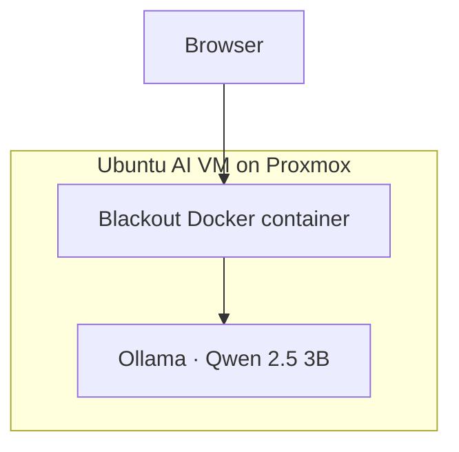

# Blackout

**When networks fail, keep asking.**

Blackout is a browser-based terminal for a language model running on your own hardware. Built for Patriot HackFest's dystopian theme, it explores how a community could retain access to a general-purpose AI tool when outside networks and cloud services become unavailable.

The application supports general questions, follow-up context, new conversations, and connection errors. It uses **Qwen 2.5 3B through local Ollama**, with a Python backend and a responsive HTML/CSS/JavaScript interface. It does not browse the web or retrieve documents.

## Built on my homelab

Blackout runs on an Ubuntu virtual machine hosted by my Proxmox server. Ollama runs the model locally, and a separate Docker container serves Blackout's interface and backend. I use Tailscale to reach it remotely from my Mac.

This builds on my experience setting up virtual machines, Linux, Docker, GPU passthrough, and local AI. My homelab also hosts other services, including Nextcloud and Open WebUI. Blackout is its own application and does not use Open WebUI as its frontend.

The infrastructure and existing AI deployment predate the hackathon. The Blackout application, interface, and project documentation are the work developed for this submission with AI assistance.



## What offline means

Once the runtime, application, and model are downloaded, inference requires no cloud AI service or external internet. The browser must still reach the server. A browser and server on the same reachable local network can operate without outside internet; accessing a home server from campus through Tailscale still requires connectivity. Power is necessary.

The user has confirmed a working Ollama connection on the homelab. A complete WAN-disconnected browser-to-server test has not yet been documented. No simulated offline indicator is used.

## Run locally with Python

Requires Python 3.10+ and an installed Ollama service. No Python packages are required.

```bash
ollama pull qwen2.5:3b
python3 app.py
```

Open http://127.0.0.1:8787. Ollama defaults to http://127.0.0.1:11434.

Configuration through environment variables:

| Variable | Default | Purpose |
| --- | --- | --- |
| `OLLAMA_URL` | `http://127.0.0.1:11434` | Local Ollama base URL |
| `OLLAMA_MODEL` | `qwen2.5:3b` | Installed model tag |
| `BIND_HOST` | `127.0.0.1` | Application bind address |
| `PORT` | `8787` | Application port |

For LAN access, set `BIND_HOST` to the server's reachable LAN IP and use that address in the browser. Limit access to intended users through the host firewall or network controls. This prototype has no application login or TLS; do not expose it to the public internet.

## Run with Docker on Linux

With Ollama running on the host:

```bash
docker build -t blackout .
docker run -d --name blackout-app --restart unless-stopped \
  --network host \
  -e BIND_HOST=127.0.0.1 \
  -e OLLAMA_URL=http://127.0.0.1:11434 \
  -e OLLAMA_MODEL=qwen2.5:3b \
  blackout
```

Set `BIND_HOST` to an appropriate LAN or Tailscale interface address for access from another device. The host-network example targets Linux. Docker Desktop on macOS uses different networking; the Python method is the simplest Mac setup.

## How chat works

The browser sends the current conversation to `/api/chat`. Python validates message roles, sizes, and content, then calls Ollama's chat endpoint. Replies are rendered as plain text rather than interpreted as HTML. The interface keeps up to nine prior exchanges when sending a new message. The model uses a 4,096-token context window, so long conversations can be truncated. Replies are capped at 600 generated tokens.

Conversation history lives in the browser tab's memory, is sent to the local backend/model for each reply, and clears on reload or New chat. Blackout has no persistent conversation database. Ollama, the host, or network infrastructure may have their own logging behavior.

## Limitations

- A general-purpose model can produce inaccurate answers. It is not a verified emergency information source.
- No live reports, sensors, tools, local resource directory, or document retrieval.
- No accounts, persistent history, streaming responses, or multi-user inference queue.
- The first reply can be slower while the model loads. Hardware determines performance.
- HTTP calls wait up to 180 seconds before returning a timeout error.

## Testing

```bash
python3 -m unittest -v test_app.py
```

Tests use a mock Ollama endpoint to check model selection, follow-up context, invalid input rejection, and connection-error handling. They do not measure real model quality or prove offline operation.

## Credits

Solo project by JK, with ChatGPT assistance for code generation, interface design, testing, and documentation. Proxmox, Ubuntu, Docker, Ollama, and Qwen are existing external components with their own licenses. No model weights or credentials are included in this repository.
